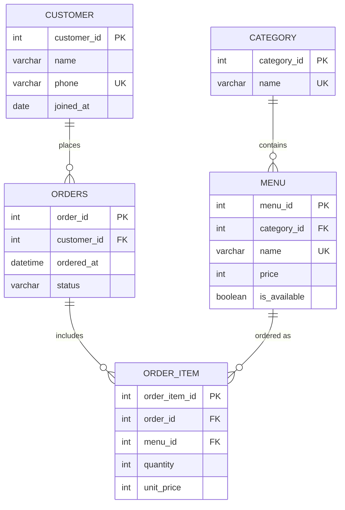

# 카페 주문 DB — SQL 데이터베이스 실습

AI/SW 기초 · 데이터베이스와 백엔드 미션. 백엔드 프레임워크 없이 MySQL로 테이블을 설계하고(PK/FK/제약조건), 샘플 데이터를 넣고, 요구사항을 SQL 쿼리로 해결하는 전체 흐름을 실습한 결과물입니다.

## 1. 개요

- **주제**: 카페 주문 (고객 / 메뉴 카테고리 / 메뉴 / 주문 / 주문 상세)
- **DB**: MySQL 8.0
- **사용 도구**: MySQL 클라이언트(Workbench, DBeaver 등 SQL을 실행하고 결과를 확인할 수 있는 도구)

## 2. 폴더 구성

| 파일/폴더 | 내용 |
|---|---|
| [schema.sql](schema.sql) | 테이블 생성 스크립트 (DB 생성 → 5개 테이블 → PK/FK/제약조건) |
| [data.sql](data.sql) | 샘플 데이터 INSERT (부모 테이블부터 순서대로) |
| [queries.sql](queries.sql) | 핵심 쿼리 15개 (기본조회/조인/집계/서브쿼리/인덱스/수정·삭제) |
| [images/](images/) | 각 쿼리 실행 결과 스크린샷 |

## 3. 실행 순서

```sql
source schema.sql;   -- cafe DB 및 테이블 생성
source data.sql;     -- 샘플 데이터 입력
source queries.sql;  -- 쿼리 15개 실행 (Q14, Q15는 데이터를 변경하므로 가장 마지막에 실행됨)
```

## 4. 테이블 구조 (ERD)



**1:N 관계 4개**: `category → menu`, `customer → orders`, `orders → order_item`, `menu → order_item`

**제약조건**: `customer.phone` UNIQUE, `category.name` / `menu.name` UNIQUE, 전 컬럼 대부분 NOT NULL, `order_item`은 `(order_id, menu_id)` UNIQUE + `order_id`에 `ON DELETE CASCADE`.

## 5. 핵심 쿼리 15개 & 실행 결과

### 기본 조회
| # | 설명 | 결과 |
|---|---|---|
| Q1 | 가격 5000원 이상 메뉴를 비싼 순으로 조회 | [1.png](images/1.png) |
| Q2 | 가장 최근 가입한 고객 5명 조회 | [2.png](images/2.png) |
| Q3 | 현재 판매 중지된 메뉴 조회 | [3.png](images/3.png) |
| Q4 | 2026년 11월 주문을 시간순으로 조회 | [4.png](images/4.png) |

### 조인
| # | 설명 | 결과 |
|---|---|---|
| Q5 | (INNER JOIN) 메뉴-카테고리 이름 함께 조회 | [5.png](images/5.png) |
| Q6 | (INNER JOIN) 주문 상세 내역(누가/언제/무엇을/몇 개/얼마) | [6.png](images/6.png) |
| Q7 | (LEFT JOIN) 메뉴가 하나도 없는 카테고리 찾기 | [7.png](images/7.png) |
| Q8 | (LEFT JOIN) 고객별 주문 횟수(주문 없는 고객도 0으로 표시) | [8.png](images/8.png) |

### 집계
| # | 설명 | 결과 |
|---|---|---|
| Q9 | 판매 수량 TOP 5 메뉴 (취소 주문 제외) | [9.png](images/9.png) |
| Q10 | 카테고리별 메뉴 개수와 평균 가격 | [10.png](images/10.png) |
| Q11 | 일별 매출 합계 (결제 완료 주문만) | [11.png](images/11.png) |

### 서브쿼리
| # | 설명 | 결과 |
|---|---|---|
| Q12 | 한 번도 주문하지 않은 고객 찾기 | [12.png](images/12.png) |

### 인덱스
| # | 설명 | 결과 |
|---|---|---|
| Q13 | `orders.ordered_at`에 인덱스 생성 — 날짜 범위로 주문을 조회하는 쿼리(Q4, Q11)가 많아 조회 속도를 위해 적용 | 생성 전 [13_before.png](images/13_before.png) → 생성 후 [13_after.png](images/13_after.png) |

### 수정 / 삭제
| # | 설명 | 결과 |
|---|---|---|
| Q14 | 대기 중이던 14번 주문을 완료 처리 (UPDATE) | 전 [14_before.png](images/14_before.png) → 후 [14_after.png](images/14_after.png) |
| Q15 | 취소된 13번 주문 삭제, `ON DELETE CASCADE`로 주문 상세도 함께 삭제 (DELETE) | 전 [15_before_1.png](images/15_before_1.png) / [15_before_2.png](images/15_before_2.png) → 후 [15_after_1.png](images/15_after_1.png) / [15_after_2.png](images/15_after_2.png) |

## 6. 요구사항 체크리스트

- [x] 테이블 4개 이상 (5개: customer, category, menu, orders, order_item)
- [x] 1:N 관계 2개 이상 (4개)
- [x] 모든 테이블 PK 보유
- [x] FK 2개 이상으로 1:N 관계 구성 (4개, InnoDB로 실제 참조 무결성 동작)
- [x] NOT NULL 1개 이상 / UNIQUE 1개 이상
- [x] 테이블당 샘플 데이터 10행 이상 (customer 12 / category 10 / menu 16 / orders 15 / order_item 26)
- [x] 쿼리 15개 (기본조회 4, 조인 4, 집계 3, 서브쿼리 1, 수정·삭제 2, 인덱스 1)
- [x] 쿼리별 실행 결과 캡처 및 한 줄 설명
